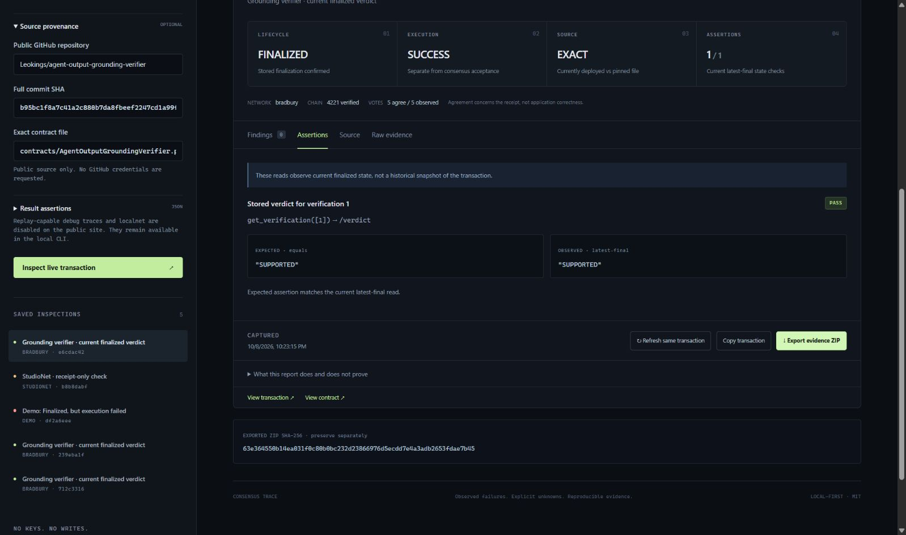
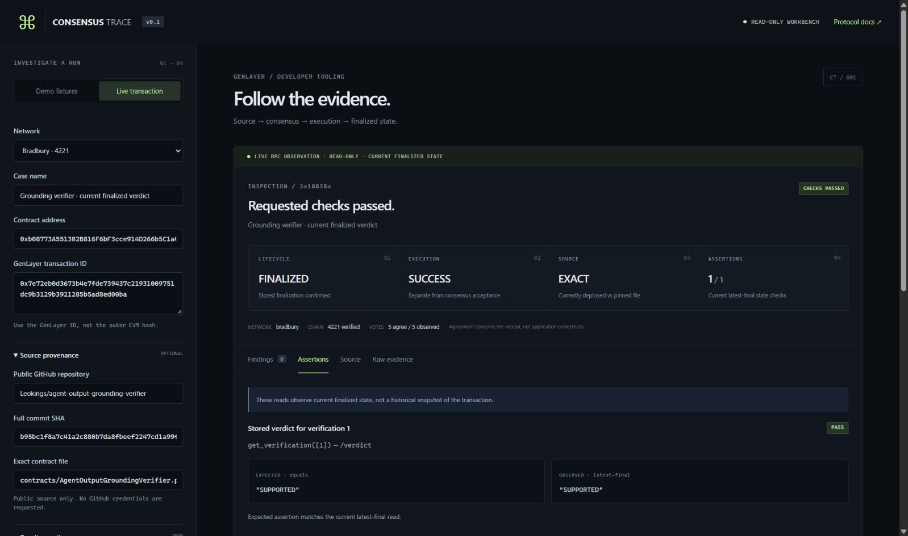

# Audited release evidence — 2026-10-08

Public MIT repository: [Leokings/consensus-trace](https://github.com/Leokings/consensus-trace). Anonymous GitHub API access confirmed `private=false`, the MIT license, and default branch `codex/hosted-release`. Source and proof were published with the user's explicit public-repository authorization.

Website: [public production alias](https://consensus-trace-leokings588-5902s-projects.vercel.app/). This is a read-only developer workbench, not a GenLayer Intelligent Contract deployment or signed test runner.

## Source, CI and deployment

- Core audit repair commit: `184ca48ff48b78b35e17994cc9ae6d6a3f81a884`; [GitHub CI passed](https://github.com/Leokings/consensus-trace/actions/runs/37846148936). Its production deployment `dpl_FSx822XwEwM78hCC6DiWA3niTfTA` reached READY. Vercel reported matching repository/branch/SHA metadata for the CLI upload.
- Final layout repair commit: `daa8b1c8a2e8869884f72aed54a3e5157bcba3e5`; [GitHub CI passed](https://github.com/Leokings/consensus-trace/actions/runs/37847396337). The layout change does not alter inspection/diagnostic code.
- Local final verification: **154 tests / eight files passed**, TypeScript and Vite production build passed, complete `npm audit --json` returned zero known vulnerabilities. There are 24 new audit regressions in addition to the original 130 tests.
- [Maintainer audit findings and limitations](audit-2026-10-08.md). This is not an independent security certification.

Final production deployment `dpl_6dsRVXRtDxKqYWciw5ow9anpEALy` reached **READY**, with Vercel Git metadata matching `daa8b1c`. Anonymous production HTML served the new `index-CxsWaXaJ.js` and `index-BPpnH6qm.css`. A fresh hosted Bradbury smoke report `3a18838a-690c-451b-83ab-07f46042d759` again returned CHECKS_PASSED in 2,931ms, exact source, successful finality, five AGREE votes and SUPPORTED. Its downloaded ZIP passed anchored verification (13 files).

The report heading moved from 482.6px to 155.2px in the same 954px viewport, with eight stored reports restored and history constrained to its own scroll area. [Release JSON](audit-release-2026-10-08.json) records the exact IDs, source commit, CI and hashes. A CLI status connection reset was not a failed build; authenticated inspection confirmed the existing deployment ID reached READY. No duplicate deployment was sent.

The [pre-layout-fix screenshot](evidence/audited-release-2026-10-08.jpg) is retained as an audit baseline, not the current UI. No critical/high finding remains open in the reviewed v0.1 scope. The operational/product limits below remain explicit; this is not a production multi-tenant readiness guarantee.

## Actual hosted workflow on the repaired inspection code

All live rows below inspect existing transactions. They do not create fresh AI consensus transactions or spend wallet funds. Tests used Chrome on the public production alias, not localhost.

| Test | Report / result | Observed evidence |
| --- | --- | --- |
| Bradbury live inspection | `e6cdac42-824d-43b1-bdba-2553ef050610` — CHECKS_PASSED | FINALIZED, SUCCESS, exact source, 5 recorded AGREE votes, `get_verification(1)` → `/verdict` = SUPPORTED; one assertion passed. Runtime 2,955ms. |
| Reload | Same `e6cdac42` restored | Five saved records remained; no new inspection request was initiated. Older version-1 reports remained readable under stricter validation. |
| Manual refresh | `0e7abfd5-e8fe-4419-8746-4197fdde1d26` — CHECKS_PASSED | Same transaction; new immutable snapshot; original preserved. Runtime 2,891ms. |
| Execution-error demo | `775a98ae-b48b-40fa-8e9d-48dd797ef037` — ISSUES_FOUND | FINALIZED stayed separate from execution ERROR. Prominent synthetic/no-network/not-submission-proof label. Runtime 2ms. |
| StudioNet manual refresh | `ac322570-7d74-4c0d-a1df-d9682b3aa6e0` — INCOMPLETE | FINALIZED/SUCCESS; 3 AGREE of 5 entries; no source/assertions; unavailable schema explicitly retained. Parent `b8b8dabf-e8ef-4d07-a853-87fea800ae0c`. Runtime 236ms. |
| Hosted negative input checks | HTTP 400 / 400 | Fixture + live input rejected; nested `api_key` test field rejected before collection. Logs contained IDs/validation/timing only, not submitted contents. |

Bradbury subject contract: `0xb08773A551302B816F6bF3cce914D266b5C1a461`. Existing transaction: `0x7e72eb0d3673b4e7fde739437c21931009751dc9b3129b3921285b5ad8ed00ba`. Public source `Leokings/agent-output-grounding-verifier`, commit `b95bc1f8a7c41a2c880b7da8fbeef2247cd1a99f`, `contracts/AgentOutputGroundingVerifier.py`. Both original source SHA-256 values: `9edcde9acd1f9206a9bd4ef4b9f491a4d39ece605597c109f3172ba7916c2d33`.

## UI-downloaded bundles, independently verified

| Downloaded evidence | Displayed external ZIP SHA-256 | CLI result |
| --- | --- | --- |
| [Repaired Bradbury report](evidence/audited-bradbury-e6cdac42-824d-43b1-bdba-2553ef050610.zip) | `63e364550b14ea031f0c80b0bc232d23866976d5ecdd7e4a3adb2653fdae7b45` | Valid, anchored, 13 files, no errors. No credential-pattern redactions needed. |
| [Repaired StudioNet report](evidence/audited-studionet-ac322570-7d74-4c0d-a1df-d9682b3aa6e0.zip) | `9797aae904c38c02deed59cd9c70e443a3ba2e5f7bb8261add3c248507a95a6d` | Valid, anchored, 10 files, no errors. Twelve sensitive-field replacements applied before export. |
| [Final production Bradbury report](evidence/final-bradbury-3a18838a-690c-451b-83ab-07f46042d759.zip) | `1b511f579b1585fa5dfceb5b6dcb01f334e2f458419f4fccf37d3d84079fc4f9` | Valid, anchored, 13 files, no errors; final deployment live smoke. |

The displayed SHA was passed separately to `npm run verify:bundle`; a self-contained manifest is not authorship/authenticity proof. Generated proof archives/screenshots are included in GitHub evidence, but excluded from the Vercel application upload. Private local history and environment/authentication files are not published.

## Observability and access limits

Production HTML/API returned HTTP 200 without credentials; current config is read-only/browser-local, StudioNet and Bradbury only, debug traces disabled. CSP, nosniff and DENY framing remain present. Unique production deployment URLs still redirect to Vercel SSO (302); no blanket protection disabling was performed.

Runtime logs corroborated all four report outcomes above. Grouped runtime-error scans returned no errors in the selected one-hour window. Chrome warnings captured were from the MetaMask extension URL, not the application. One automation locator wait timed out during reload; direct subsequent observation confirmed the report was restored. A document-root scroll target was not hit-testable; normal Ctrl+Home navigation succeeded. These are automation issues, not application error claims.

External drain configuration could not be verified: the team-scoped drain read returned 404. Do not represent that as verified zero drains or active external monitoring. No custom WAF/global distributed quota was established. These remain explicit higher-volume production-readiness limits, alongside read-only scope, current-state-only assertions, unproven historical causality, and best-effort secret detection.
