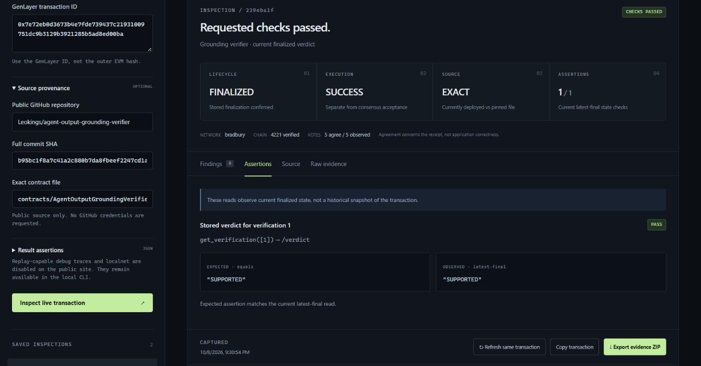

# Hosted website verification — 2026-10-08

This records the first hosted release (130 tests), before the maintainer audit. See [audited release evidence](audit-release-2026-10-08.md) for repaired source, 154 tests, public repository, and current deployment checks.

[Public production site](https://consensus-trace-leokings588-5902s-projects.vercel.app/).

Deployment `dpl_9gKt1vGi4FKRFDaWLyGRfTPGj6wQ` reached `READY` in production. The build ran in `iad1` with Vite 8.3.4 and Node 24; observed Functions ran in `cpt1`. The build/install reported zero vulnerabilities. Local verification: 130 tests across seven files passed; TypeScript/Vite build passed; `npm audit --omit=dev` found zero vulnerabilities.

The production alias returned HTTP 200 without credentials. `/api/config` returned browser storage, StudioNet/Bradbury only, read-only mode and disabled traces. The unique deployment URL returned a protected 302 redirect, rather than becoming public. CSP, `nosniff` and `DENY` framing headers were observed on the production alias. Local SQLite history, environment files and generated exports were excluded from deployment.

## Actual browser workflow

Tests used Chrome on the public production alias, not localhost. The UI initiated these read-only inspections:

| Check | Report | Result |
| --- | --- | --- |
| Existing Bradbury transaction, pinned source and current-state assertion | `712c3316-6dce-46d7-8ad1-0939bb72d26f` | `CHECKS_PASSED`; `FINALIZED`; execution `SUCCESS`; exact source; one assertion passed; five recorded AGREE votes |
| Reload | Same `712c3316` report | Restored from browser history; no new inspection invoked |
| Refresh same transaction | `239eba1f-dbb3-4cf9-aaab-1eb15d342b31` | New snapshot; same transaction link and `CHECKS_PASSED`; original snapshot remained in history |
| Explicit finalized-error fixture | `df2a6eee-61d6-4f31-a238-a4f906aba46c` | `ISSUES_FOUND`; `FINALIZED` separate from execution `ERROR`; synthetic/no-network provenance prominently visible |
| Existing StudioNet receipt, no source/assertions | `b8b8dabf-e8ef-4d07-a853-87fea800ae0c` | `INCOMPLETE`; `FINALIZED`; execution `SUCCESS`; three AGREE out of five entries; schema unavailable and missing checks preserved |

Bradbury subject: contract `0xb08773A551302B816F6bF3cce914D266b5C1a461`, transaction `0x7e72eb0d3673b4e7fde739437c21931009751dc9b3129b3921285b5ad8ed00ba`. Source: `Leokings/agent-output-grounding-verifier`, commit `b95bc1f8a7c41a2c880b7da8fbeef2247cd1a99f`, file `contracts/AgentOutputGroundingVerifier.py`. `get_verification(1)` at `/verdict` returned `SUPPORTED`, matching the expected value.

StudioNet subject: contract `0x62122cb6486bc664084dec8c93ec6a61f1c51016`, transaction `0x786d6828903e6b37e82d94e7b7ea94575369d8d34d7008b837157581658f5059`. This intentionally receipt-only case must not be described as full application verification.

## Downloaded evidence verified outside the browser

The UI generated and downloaded both ZIPs. The independently displayed UI digest was passed to the CLI verifier:

| Bundle | SHA-256 | Verification |
| --- | --- | --- |
| [Bradbury ZIP](evidence/hosted-bradbury-712c3316-6dce-46d7-8ad1-0939bb72d26f.zip) | `5060dddceeb0dc0ce3dff5179dbd2cf64d6d70a30793357ae9489b23fcad7800` | Valid; 13 files; anchored digest; no errors |
| [StudioNet ZIP](evidence/hosted-studionet-b8b8dabf-e8ef-4d07-a853-87fea800ae0c.zip) | `1c4075febaa0ebc27a3626540e2196b88041ca56354387012c3a5e17ed5a981c` | Valid; 10 files; anchored digest; no errors |

Vercel runtime logs independently recorded the live Bradbury inspection in 3,427 ms, its refresh in 3,056 ms, and the StudioNet inspection in 257 ms. Grouped runtime-error inspection found no errors in the selected one-hour window. Browser warnings observed were from the MetaMask extension, not the application origin. An initial automation download-event wait timed out; an ordinary UI export then downloaded successfully and was externally verified. A full-page screenshot request timed out; the supported screenshot surface captured the result successfully.

## Scope and provenance

These are inspections of existing transactions, not new signed tests or a Consensus Trace Intelligent Contract deployment. Current finalized-state values are not proof of historical causality. Source matching concerns currently retrieved deployed code. Self-contained hashes are not independently authenticated chain proofs.

Local source snapshot: `dae2310d1bd2062acad7e29fe092aef3ceeaa015`. The Vercel deployment was uploaded by CLI from that source content before the local commit was recorded; Vercel returned empty Git metadata. This is a manually recorded local source reference, not a platform-verified Git deployment binding. Subsequent commits add verification documentation and evidence without changing deployed application code.

The hosted API is public and stateless; histories are browser-private. Per-instance admission control is not a global quota, and no custom WAF policy was verified. Debug traces/localnet are disabled publicly. This release is not an independent security audit.
